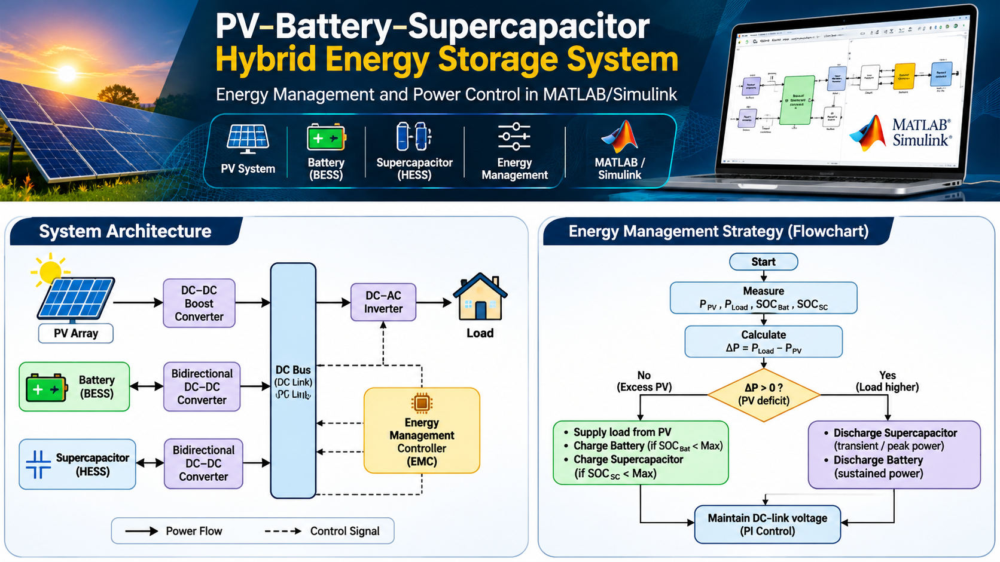

## PV-Battery-Supercapacitor Hybrid Energy Storage System

## Project Overview

This project focuses on PV-based hybrid energy storage
using battery and supercapacitor systems in MATLAB/Simulink.
A standalone photovoltaic (PV) energy system integrated with a hybrid energy storage system consisting of a battery and supercapacitor. The model demonstrates coordinated energy management, DC–DC power conversion, MPPT control and dynamic response under changing operating conditions.

## Project Overview

This project models a standalone PV–Battery–Supercapacitor Hybrid Energy Storage System in MATLAB/Simulink.

The battery provides sustained energy storage, while the supercapacitor supports rapid transient power demands. An energy management strategy coordinates the power flow between the PV source, battery, supercapacitor and load.

## System Architecture

The simulation includes:

- Solar PV generation system
- Perturb and Observe (P&O) MPPT controller
- DC–DC boost converter
- Bidirectional DC–DC converter for battery
- Bidirectional DC–DC converter for supercapacitor
- Battery and supercapacitor models
- Combined control and energy management subsystem
- DC-link and electrical load
- Voltage, current, SOC and power monitoring

## Control and Modelling

The model incorporates:

- P&O-based maximum power point tracking
- PI-based DC-link voltage regulation
- PWM-based converter switching
- Battery and supercapacitor power coordination
- SOC monitoring
- Dynamic simulation under changing PV conditions

## Simulation Results

The simulation results demonstrate:

- PV voltage and current response
- PV power variation under changing irradiance
- Supercapacitor voltage, current and SOC response
- Battery voltage, current and SOC response
- DC-link voltage regulation
- Power distribution between storage elements and load
- Transient response during operating-condition changes

The uploaded simulation scope captures the system response over a 2-second simulation interval, including a change in operating conditions at approximately 1 second.

## Project Files

| File / Folder | Description |
|---|---|
| `Battery_SC_Control.slx` | Main Simulink model |
| `resources/` | Supporting project resources |
| `README.md` | Project documentation |

## Software

- MATLAB
- Simulink
- Simscape Electrical (where required by the model)
- MATLAB R2024a environment

## Engineering Skills

I work on MATLAB/Simulink-based engineering modelling, simulation and control systems, with experience in:

- Power electronics and DC–DC converters
- Renewable energy and photovoltaic systems
- Battery Energy Storage Systems (BESS)
- Supercapacitor energy storage
- MPPT algorithms
- Converter control and PI controllers
- Electric vehicle and charging-system modelling
- Microgrids and smart-grid simulations
- Control systems and dynamic modelling
- Simulation result analysis and technical documentation

## About the Engineer

I am an Electrical Engineer specialising in MATLAB and Simulink modelling, power electronics, renewable energy systems and control-system simulations.

I undertake engineering simulation and modelling projects for researchers, engineering professionals, students seeking technical guidance, and companies working on electrical and energy systems.

## Contact & Collaboration

**Available for MATLAB/Simulink engineering projects, technical consulting and collaboration.**

- **Email:** matlinkexpert@gmail.com
- **WhatsApp:** +91 8140265253
- **GitHub:** [BurhanuddinA](https://github.com/BurhanuddinA)

For project enquiries, technical discussions or collaboration opportunities, feel free to contact me.

---

*This repository presents an original engineering simulation project developed by me. The model files and documentation are shared for technical learning, reference and professional collaboration.*
